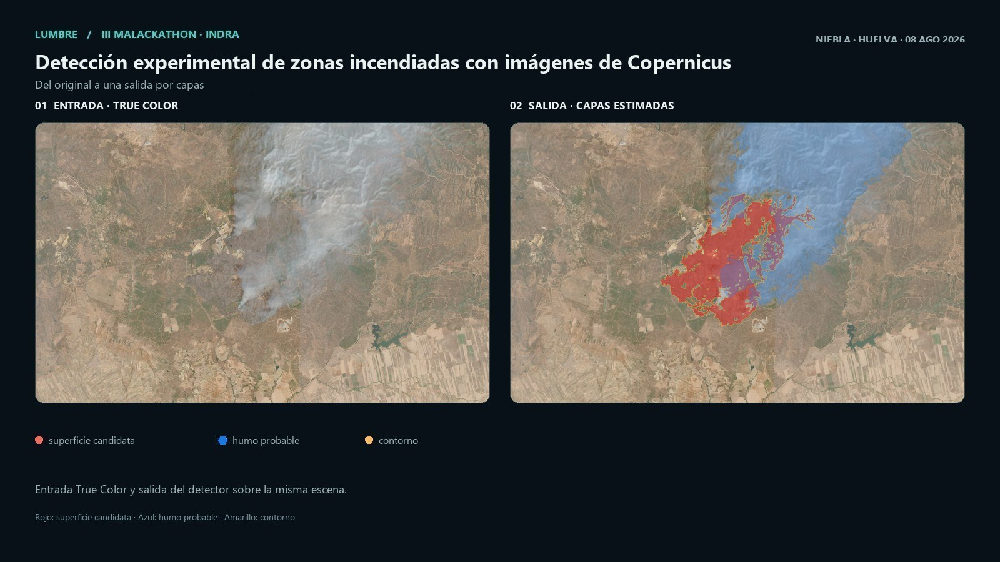
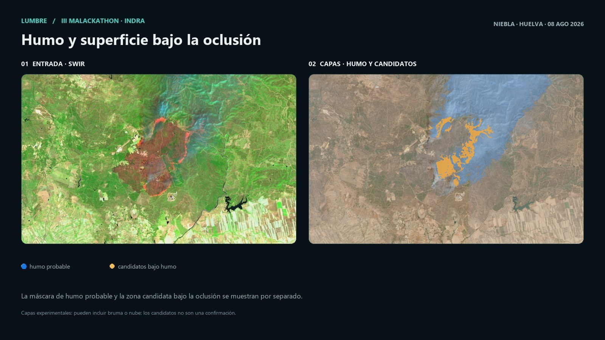
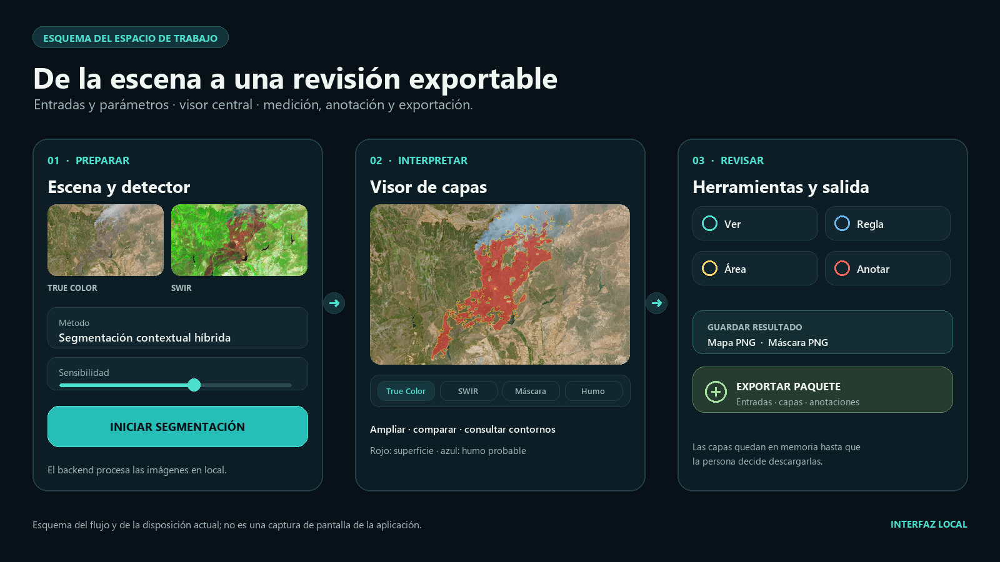
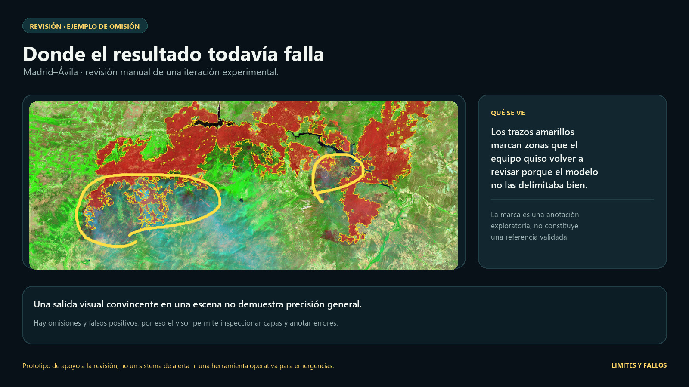

# Lumbre · análisis satelital de incendios

Prototipo experimental para revisar imágenes satelitales **True Color** y **SWIR** de Copernicus y localizar zonas candidatas de superficie afectada. Presenta por separado el humo probable y los candidatos bajo humo para facilitar la revisión, medición, anotación y exportación del análisis.

Nació en la **III Malackathon 2026 de la Universidad de Málaga**, para el reto de Indra Espacio. Éramos cuatro estudiantes de primer curso: tres de Ciberseguridad e Inteligencia Artificial y uno de Informática. [La historia del proyecto](DOCUMENTACION/historia_del_proyecto.md) conserva cómo evolucionó el trabajo y qué quedó fuera del prototipo.

*Niebla, Huelva · 08/08/2026. La entrada y la salida corresponden a la misma escena y ejecución. Rojo: superficie candidata; azul: humo probable; borde azul oscuro: límite de esa máscara; amarillo: contorno de superficie. Es una salida experimental, no una medida de precisión.*

## Qué permite hacer

- Abrir escenas de muestra o cargar una pareja de imágenes propias.
- Analizar las composiciones True Color y SWIR y cambiar entre las capas disponibles: superficie candidata, máscara, humo probable, zona candidata bajo humo y clases semánticas.
- Comparar contornos y revisar las zonas en el visor central.
- Medir distancias y áreas cuando se dispone de una escala GSD adecuada.
- Anotar con trazos, líneas, flechas, formas y texto para registrar observaciones.
- Descargar un mapa o una máscara, o exportar un paquete ZIP para analizarlo después con otra herramienta o con IA.

### Humo y superficie bajo la oclusión

El análisis mantiene por separado la superficie visible, el humo probable y los píxeles que podrían corresponder a superficie bajo humo. Esa separación ayuda a revisar la escena; no convierte una hipótesis en una observación confirmada.

*Niebla, Huelva · 08/08/2026. Azul: humo probable con un borde fino más oscuro; naranja: superficie candidata bajo la oclusión. Son capas experimentales, pueden incluir bruma o nube y no confirman una superficie afectada.*

### Un flujo de trabajo en una sola ventana

Las entradas y parámetros están a la izquierda, el visor de capas en el centro y las herramientas de revisión y exportación a la derecha.

*Esquema del flujo y de la disposición actual; no es una captura de pantalla.*

## Guardar y exportar

Las capas de cada ejecución se mantienen en memoria y se descartan al cerrar Lumbre. No se escriben imágenes automáticamente en resultados: se conserva lo que la persona descarga.

El botón **Guardar resultado** permite descargar el mapa o la máscara. **Exportar paquete** genera un ZIP con las entradas preparadas en la rejilla del análisis, las capas y máscaras disponibles, bordes, parámetros, métricas, un mapa anotado y las anotaciones en JSON y SVG. El manifiesto registra la escena y la escala disponible, y deja explícitas las limitaciones de alineación y georreferenciación.

## Instalación e inicio

Se necesita **CPython estándar de 64 bits, versión 3.11, 3.12, 3.13 o 3.14**. El instalador comprueba que la versión tenga ruedas binarias compatibles con las dependencias del proyecto.

En Windows, instala [Python Install Manager](https://www.python.org/downloads/windows/) desde python.org o Microsoft Store. Si aún no tienes un runtime, abre una terminal y ejecuta <code>py install 3.14</code>. Desde la raíz del repositorio:

1. Ejecuta <code>01_instalar_lumbre.bat</code> una vez.
2. Ejecuta <code>02_iniciar_lumbre.bat</code> para abrir la aplicación.
3. Ejecuta <code>04_cerrar_lumbre.bat</code> para cerrar Lumbre cuando termines.

<code>03_acceso_movil.bat</code> configura el acceso opcional desde el teléfono. Actívalo, cierra y vuelve a iniciar Lumbre, y conecta ambos dispositivos a la misma Wi-Fi privada. Si Windows pregunta, permite el acceso solo en redes privadas. En macOS o Linux, inicia con <code>python3 -m lumbre --host 0.0.0.0</code>. Esto no configura el router; el acceso está pensado para una red Wi-Fi privada, no para publicar la aplicación en Internet. La aplicación funciona en el ordenador sin habilitar el acceso móvil.

El instalador detecta un Python compatible e instala las dependencias de ejecución del único <code>requirements.txt</code>; no modifica PATH ni requiere permisos de administrador.

En macOS o Linux, usa un CPython compatible y, desde la raíz, instala las dependencias para tu usuario:

    python3 -m pip install --user -r requirements.txt
    python3 -m lumbre

Si la distribución bloquea instalaciones con <code>pip --user</code> por proteger su Python del sistema, crea un entorno local y úsalo para iniciar Lumbre:

    python3 -m venv .venv
    source .venv/bin/activate
    python -m pip install -r requirements.txt
    python -m lumbre

El paquete web está incluido. Node.js solo hace falta para desarrollar la interfaz. Para cerrar Lumbre, pulsa Ctrl+C en la ventana del servidor.

## Uso y desarrollo

Elige una escena precargada o carga una pareja True Color/SWIR de la misma adquisición y con dimensiones coincidentes. Inicia la segmentación, cambia las capas del visor y usa las herramientas **Ver**, **Regla**, **Área** y **Anotar**. El formato RGB o el tamaño iguales no garantizan por sí solos que dos imágenes estén alineadas geográficamente.

Para ejecutar las pruebas disponibles:

    python -m pip install --user -r requirements.txt
    python -m pip install --user "pytest>=8,<10"
    python -m pytest -c tests/pytest.ini tests

Si usas el entorno <code>.venv</code>, omite <code>--user</code> en los dos comandos de instalación.

Las pruebas que generen archivos deben escribirlos en <code>tmp_path</code>. Para inspeccionar una salida manual entre procesos, usa <code>.tmp/pruebas/&lt;nombre&gt;/</code>; no uses <code>resultados/</code>. Conserva a largo plazo solo resultados elegidos, dentro de <code>resultados/guardados/&lt;nombre&gt;/</code>, con su procedencia y parámetros.

La interfaz editable está en <code>frontend/</code>; el paquete que sirve el backend está en <code>web/</code>. Para desarrollar, inicia el backend con <code>python -m lumbre --no-browser</code> y, en otra terminal:

    cd frontend
    npm ci
    npm run dev

Vite requiere Node.js ^20.19.0 o >=22.12.0. Para regenerar el paquete de producción, ejecuta <code>npm run build</code> en <code>frontend/</code>.

## Escenas, escala y alcance

Las parejas de muestra están en <code>imagenes_muestra/</code>. Los nombres de archivo identifican composiciones True Color y SWIR y, en varios casos, incluyen “Sentinel-2 L2A”; el repositorio no conserva el identificador de producto ni verifica de forma independiente toda su procedencia. <code>Wildfires</code>, cuando está disponible, aporta una referencia visual de focos, no una máscara validada ni una medición térmica.

En escenas precargadas puede aplicarse un GSD nominal de catálogo de 10 m/píxel. Sirve para estimar distancias y áreas en la rejilla local, pero no aporta coordenadas terrestres, CRS ni una transformación geográfica fiable. En imágenes propias sin escala conocida, las mediciones quedan en píxeles. Las composiciones renderizadas no conservan necesariamente las bandas originales o la reflectancia; Lumbre no calcula NBR ni dNBR a partir de ellas.

Las detecciones son **candidatas experimentales**, no confirmaciones de área quemada, fuego activo o humo. No hay suficientes etiquetas externas independientes para afirmar una precisión general. Lumbre es un prototipo de revisión visual, no un sistema operativo de alerta o apoyo a emergencias.

## Documentación y estructura

- [Historia y evolución del proyecto](DOCUMENTACION/historia_del_proyecto.md)
- [Índice de documentación](DOCUMENTACION/README.md)
- [Ideas, decisiones y estado actual](DOCUMENTACION/Ideas/README.md)
- [Flujo básico, GSD y mediciones](DOCUMENTACION/Ideas/segmentacion_basica.md)
- [Escenas de muestra y procedencia](imagenes_muestra/README.md)
- [Guía de entrenamiento Random Forest](training/random_forest/README.md)

El backend Python está en <code>lumbre/</code>; la interfaz editable, en <code>frontend/</code>; las escenas, en <code>imagenes_muestra/</code>; las herramientas de evaluación, en <code>scripts/</code>; y los resultados seleccionados para conservar, en <code>resultados/</code>. <code>main</code> es la rama activa del proyecto; para una copia nueva:

    git clone --single-branch --branch main https://github.com/emilioreato/malackathon2026.git

## Fallos observados en las pruebas

En una revisión manual de una iteración experimental para Madrid–Ávila señalamos zonas que el resultado no delimitaba bien. Los trazos amarillos de la imagen son observaciones del equipo, no una referencia de verdad terreno. También vimos falsos positivos, en especial al separar humo, nube y bruma.

*La salida visual puede ser llamativa y aun así omitir zonas o marcar superficies que requieren revisión. Por eso el README muestra candidatos, no una precisión demostrada.*
